# Kunci Jawaban Final Project Klinik Pratama

Isi folder ini adalah acuan penilaian: skema, data, objek basis data, dan skrip
yang harus dicapai tim. Semua perintah dijalankan lewat klien SQL; tidak ada
aplikasi Java, PHP, atau antarmuka grafis.



## Daftar Isi

1. [Isi Folder](#isi-folder)
2. [Prasyarat](#prasyarat)
3. [Urutan Menjalankan](#urutan-menjalankan)
4. [Hasil yang Diharapkan](#hasil-yang-diharapkan)
5. [Catatan Angka Query](#catatan-angka-query)
6. [Struktur Berkas](#struktur-berkas)
7. [Masalah Umum](#masalah-umum)

## Isi Folder

| Berkas | Pemilik | Isi |
|---|---|---|
| `sql/00-kesepakatan.sql` | P1 | nama objek, aturan bisnis, kamus data, kardinalitas |
| `sql/01_struktur.sql` | P3 | 11 tabel, kunci, 10 foreign key, constraint |
| `sql/02_data.sql` | P2 | data contoh semua tabel, termasuk keadaan khusus untuk uji |
| `sql/03_view_trigger.sql` | P4 | 2 view dan 4 trigger |
| `sql/04_prosedur.sql` | P4 | `sp_daftar_kunjungan`, `sp_bayar_kunjungan` |
| `sql/05_keamanan.sql` | P4 | 3 pengguna dan hak aksesnya |
| `sql/06_indeks.sql` | P4 | `idx_pasien_nama`, `idx_kunjungan_tanggal` |
| `sql/07_pengujian.sql` | P5 | 10 skenario uji, sengaja menghasilkan galat |
| `sql/08_kueri.sql` | P4/P5 | Q1 sampai Q10 sesuai PRD bagian 7 |
| `tools/reset-db.sh` | P5 | bangun ulang database dari nol |
| `tools/verify.sh` | P5 | 34 pemeriksaan isi dan perilaku |
| `tools/demo-isolasi.sh` | P5 | bukti READ COMMITTED, REPEATABLE READ, deadlock 1213 |
| `tools/db.sh` | P5 | pemilih koneksi Docker atau MySQL host |
| `tools/build.sh` | P5 | bangun PDF laporan |
| `docs/kesepakatan.md` | P1 | kesepakatan kelompok versi Markdown |
| `docs/alur-muat.mmd` | P5 | sumber diagram alur muat |
| `docs/build-flow.sh` | P5 | kompilasi ulang diagram jadi SVG |
| `panduan/gambar/erd.tex` | P1 | ERD versi LaTeX/TikZ |
| `panduan/gambar/erd.drawio` | P1 | ERD versi draw.io |
| `laporan/template-laporan.tex` | P1 | kerangka laporan, termasuk Bab I dan Bab III |
| `bukti/` | semua | keluaran perintah yang dipakai sebagai bukti |

## Prasyarat

- MySQL 8.0.16 atau lebih baru, atau MariaDB bawaan XAMPP untuk latihan lokal.
- `bash` (Git Bash di Windows), `mysql` client, dan `node` bila ingin
  mengompilasi ulang diagram.
- MiKTeX bila ingin membangun PDF laporan.

## Urutan Menjalankan

```bash
bash tools/reset-db.sh
bash tools/verify.sh
bash tools/demo-isolasi.sh
bash tools/build.sh
```

1. `reset-db.sh` menghapus database, lalu memuat `01` sampai `06`.
2. `verify.sh` memeriksa 34 butir (bagian A sampai G).
3. `demo-isolasi.sh` membuktikan tingkat isolasi dan deadlock.
4. `07_pengujian.sql` dijalankan terpisah karena sengaja gagal:

```bash
source tools/db.sh
db --force < sql/07_pengujian.sql
```

`db.sh` memilih container `kbd-mysql`, container `mysql`, atau MySQL host di
`127.0.0.1:3306`. Setelan dapat diubah lewat `KBD_HOST`, `KBD_PORT`, `KBD_USER`,
`KBD_ROOT_PW`, dan `KBD_CT`.

## Hasil yang Diharapkan

```text
bash tools/reset-db.sh  -> tabel terdaftar: 11
bash tools/verify.sh    -> Lulus: 34   Gagal: 0
bash tools/demo-isolasi.sh -> deadlock terdeteksi, galat 1213
```

Keluaran lengkap tersimpan di `bukti/`:

| Berkas | Asal |
|---|---|
| `00-reset.txt` | `tools/reset-db.sh` |
| `03_view_trigger.txt` | `sql/03_view_trigger.sql` |
| `04_prosedur.txt` | `sql/04_prosedur.sql` |
| `05_keamanan.txt` | `sql/05_keamanan.sql` |
| `06_indeks.txt` | `sql/06_indeks.sql` |
| `07_pengujian.txt` | `sql/07_pengujian.sql` dengan `--force` |
| `10-kueri.txt` | `sql/08_kueri.sql` |
| `kueri-panduan.sql` | salinan `sql/08_kueri.sql` |
| `isolasi.txt` | `tools/demo-isolasi.sh` |
| `verify.txt` | `tools/verify.sh` |

## Catatan Angka Query

Angka acuan PRD bagian 7 berasal dari dataset contoh di panduan. Dataset kunci
ini sedikit berbeda, sehingga sebagian hasil Q berbeda dan sudah disesuaikan di
`docs/kesepakatan.md`:

| Query | PRD | Kunci ini |
|---|---|---|
| Q1 | 10 baris, tertua Gilang Ramadhan | sama |
| Q2 | 6 dokter | sama |
| Q3 | 14 baris | sama |
| Q4 | jadwal 7 sisa 0 | sama |
| Q5 | 3 baris | sama |
| Q6 | 2 pasien | 6 pasien |
| Q7 | Poli Umum, Gigi, Penyakit Dalam | Poli Anak |
| Q8 | Amlodipine 60 tablet | sama |
| Q9 | 5 Ringan, 3 Sedang, 2 Berat | 5 Sedang, 5 Berat |
| Q10 | dr. Andi Pratama peringkat 1 | sama |

Perbedaan Q6, Q7, dan Q9 berasal dari sebaran poli dan nilai tagihan pada data
contoh, bukan dari kesalahan query. Semua query tetap memakai teknik yang
diminta PRD.

## Struktur Berkas

```text
.
├── sql/                 delapan skrip SQL
├── tools/               reset, verify, isolasi, db, build
├── bukti/               keluaran perintah
├── docs/                kesepakatan dan diagram alur
├── panduan/gambar/      sumber ERD
└── laporan/             kerangka laporan dan PDF
```

## Masalah Umum

| Gejala | Sebab | Perbaikan |
|---|---|---|
| `ERROR 2003 Can't connect to MySQL server` | server belum siap | tunggu, ulangi `reset-db.sh` |
| `ERROR 1046 No database selected` | perintah manual tanpa `USE` | pakai `source tools/db.sh` atau skrip |
| `verify.sh` gagal bagian E | data contoh berubah | jalankan `reset-db.sh` |
| `pdflatex tidak ditemukan` | MiKTeX belum ada di PATH | pasang MiKTeX atau pakai `tools/build.sh` |
| `ERROR 1030 ... storage engine Aria` | tabel hak akses MariaDB rusak | hapus `FLUSH PRIVILEGES` (tidak diperlukan) |
